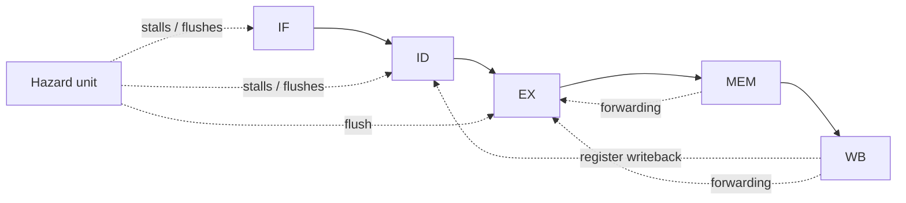

# CA4 — Five-Stage Pipelined RISC-V-Style CPU

## Overview

This project contains a 32-bit pipelined CPU organized into the conventional five stages:

1. **IF** — Instruction Fetch
2. **ID** — Instruction Decode / Register Read
3. **EX** — Execute / Address Calculation
4. **MEM** — Data Memory Access
5. **WB** — Register Write-Back

Pipeline registers carry data and control signals between stages. The design also contains forwarding and hazard-control logic for selected data and control dependencies.

## Architecture



- `Top.v` — integrates instruction memory, CPU and data memory.
- `CPU.v` — connects the five pipeline stages and hazard/forwarding paths.
- `reg.v` — pipeline registers `Reg_D`, `Reg_E`, `Reg_M` and `Reg_W`.
- `Controller.v` — instruction decode and control-signal generation.
- `hazard_unit.v` — forwarding selection, load-use stall and flush control.
- `ALU.v` — arithmetic, logical and comparison operations.
- `Reg_File.v` — 32-entry register file.
- `Inst_Mem.v`, `data_mem.v` — instruction and data memories.
- `Ins_Fetch.v`, `pc.v`, `PC_adder.v`, `PCTarget_adder.v`, `PCSrcSel.v`, `pc_mux.v` — fetch and control-flow support.
- `Imm_Ext.v` — immediate generation.
- `mux.v`, `res_mux.v`, `WD3_mux.v` — datapath selection logic.
- `TB.v` — top-level testbench.
- `Inst.txt` — starter instruction image loaded using `$readmemh`.

## Hazard handling present in the source

The supplied `hazard_unit.v` includes:

- EX-stage forwarding selection from later pipeline stages.
- A load-use dependency check that can stall fetch/decode.
- EX and ID flush control for selected control-flow events.

These mechanisms are present in the RTL, but their correctness and priority must be validated with directed tests.

## Simulation

Run `run_simulation.bat` on Windows after installing Icarus Verilog, or use:

```bash
iverilog -g2012 -s TB -o cpu_sim *.v
vvp cpu_sim
```

Keep `Inst.txt` in the simulator's working directory.

## Instruction image warning

The uploaded archive did not contain `Inst.txt`, although `Inst_Mem.v` loads it. A 32-word starter image has been added containing only `00000013` (`addi x0, x0, 0`) NOP instructions. This initializes the instruction memory but is **not** the original assignment program and does not verify the CPU's behavior. Replace it with the intended program before meaningful simulation.

## Review items

- Verify forwarding priority and the `ResultSrc` encodings across the hazard unit, pipeline registers and result mux.
- Verify load-use detection, including cases where `rs2` is not a source operand (for example, immediate instructions); the current detector compares both decoded source fields.
- Test branch/jump resolution, pipeline flushes and PC update timing.
- Review reset and flush behavior in each pipeline register.
- Add dependency-heavy test programs covering EX/MEM and MEM/WB forwarding, load-use stalls, branches, jumps and back-to-back writes.
- Document the exact supported instruction subset and expected register/memory results.

## Status

The five-stage pipeline structure and hazard-control modules are present. Functional correctness, timing, synthesis readiness and complete RV32I compliance have not been established.
